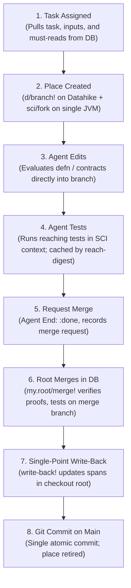

# Pitch: Reject Git Worktrees per Agent; Accrete on Datahike Branches with Single-Root Write-Back

**Author:** Seon Lane `pitch-flash-high`  
**Date:** 2026-10-14  
**Target:** Owner Ruling on Agent Workspaces, Branch Alignment, and File Sync  

---

## 1. The Pitch (Page 1)

### The Decision Asked
Should every Seon agent get a git worktree aligned with its Datahike branch and SCI context, so many agents work in parallel and conflicts are resolved at merge?

### The Recommendation
**NO. Do not give every agent a git worktree.**  
Git worktrees are the wrong tool for Seon's agent concurrency. Aligning a git worktree with every agent's Datahike branch and SCI context revives the failure modes that forced their removal in September 2026, violates the law of shared incremental computation, multiplies disk and cache costs, and contradicts the owner's dream: *"The goal is the DB is the source of truth and we write to the files once we've vetted it."*

### Why
1. **A worktree puts files back as the intermediate authority.**  
   If an agent works in a private git worktree, files become the working medium. Edits take place as line-oriented file diffs, triggering Babashka hooks, local linter runs, and file parsing. But the dream states that the database is the source of truth, where agents experiment on an SCI branch, vet everything in memory, merge to main, and only then write to disk. A git worktree moves in the exact opposite direction: it multiplies the file system by $N$ agents.

2. **Git worktrees fail Seon's dependency and classpath architecture.**  
   [VERIFIED: `deps.edn#L14-L45`] Seon vendors and maintains forks via local roots (`:local/root "reference-code/malli"`, `clj-kondo`, `datahike`, `editscript`). In a fresh worktree, git submodules are uninitialized empty directories. [MEASURED: `bin/seon-hook` execution in worktree] The edit hook fails immediately with `Manifest file not found for metosin/malli`. Populating submodules across worktrees duplicates 250 MB per agent or introduces shared-state cross-talk across symlinks.

3. **Dual merge creates semantic divergence.**  
   In a worktree model, two merges must occur: a git merge (line-based text hunks) and a Datahike merge (`seon.merge/merge!`, AST and entity-based Datalog facts). When two agents edit disjoint functions within the same file, git merge can fail or produce syntactic noise on imports/requires, while Datahike's AST merge is completely trivial. Conversely, two textually clean git hunks can silently break cross-function semantics. Resolving conflicts across two disparate merge engines requires fences, retries, and reconcilers—strictly prohibited by `AGENTS.md` ("NO GUARDS OR FENCES").

4. **The correct path achieves the dream without worktrees:**  
   **Pure Datahike branch + SCI context per agent on the single JVM.** Agents work at the REPL (`eval_clj`, prepl) or via language tools that transact AST entities directly into their Datahike branch. The single JVM shares all immutable derivations (`seon.cache`, compiled contracts, reach digests). Once green, root merges the Datahike branch (`my.root/merge!`). Main Datahike advances, and vetted changes are written back to the single checkout root via `seon.cluster.source/write-back!` in one git commit.

---

## 2. What the Pitch Must Answer

### Question 1: An Agent's Day, End to End (In the Dream)

In the dream, the database is the source of truth and files are the vetted write-back:



- **Step 1: Task Assigned.** Root or the orchestrator assigns a task entity (`:seon.task/assignment`).
  - *Authoritative face:* Datahike DB on cluster head.
- **Step 2: Place Created.** An agent identity is minted (e.g. `agent-<uuid>`). A cheap Datahike branch is cut (`d/branch!`) from cluster head commit `H_db`. An SCI context is forked (`sci/fork`) holding the branch connection. No files or worktrees are created.
  - *Authoritative face:* Datahike agent branch + agent SCI context.
- **Step 3: Edits.** The agent works at its REPL (`eval_clj`). Evaluating `defn` reads AST forms via edamame/rewrite-clj and transacts program entities into its Datahike branch. For outside agents that prefer editor tools, a virtual file buffer or narrow temporary view is provided, which pipes directly into the branch via the REPL entrance. Disk files on main remain untouched.
  - *Authoritative face:* Datahike agent branch.
- **Step 4: Tests.** Reaching tests are selected by call-graph analysis. Tests run inside the agent's SCI context against its branch. Test results are recorded as immutable facts keyed by `:seon.test.reach/digest`. If unchanged, execution is 0 ms (cached).
  - *Authoritative face:* Agent SCI context + Datahike branch.
- **Step 5: Write-Back Prep & Merge Request.** The agent finishes with `:my.agent/retiring? true` and submits an open merge request (`my.root/merge-requests`). The agent does *not* write to disk files.
  - *Authoritative face:* Datahike agent branch.
- **Step 6: Merge.** Root picks up the merge request via `my.root/merge!`. Root forks a temporary merge branch of main, applies the candidate's declarations, verifies integrity proofs, and runs reaching tests. Upon a green verdict, main advances in Datahike in ONE transaction.
  - *Authoritative face:* Datahike main branch.
- **Step 7: Write-Back to Files.** With main updated in the DB, root invokes `seon.cluster.source/write-back!` [VERIFIED: `src/seon/cluster/source.clj:2000-2043`]. It reads the base commit and merge commit, computes changed declarations, and updates exact byte spans in the shared checkout root (`:seon.config.fs/working-root`).
  - *Authoritative face:* Datahike main commit is producer; checkout files follow deterministically.
- **Step 8: Git Commit & Place Retired.** Root commits the written-back files on git `main` (`git commit`). The agent's branch connection is released and its branch retired (`my.agent/retire-branch!`). GC collects unreferenced branch nodes.
  - *Authoritative face:* Git repository on main.

---

### Question 2: One Place, Three Faces

[PROPOSED] If three faces exist (Datahike branch, SCI context, git worktree on git branch):

1. **How they stay one identity:**
   - Identity is minted as a single canonical agent identifier: a UUID keyword/string (e.g. `:agent-b0c333cabd17`).
   - The Datahike branch is named `:agent-<uuid>`.
   - The SCI context holds `{:seon.agent/id "agent-<uuid>" :seon.db/connection <conn>}`.
   - The git branch is named `agent-<uuid>`.
   - The git worktree is checked out at a deterministic path: `tmp/agents/agent-<uuid>`.
2. **Who mints it:**
   - [VERIFIED: `src/seon/cluster/agent.clj`] The runtime host / agent registry (`seon.cluster.agent/open-agent!`) mints the identity in the cluster execution atom and transacts the agent entity into Datahike.
3. **How they stay cut from the same commit:**
   - Datahike branch cuts from cluster head commit ID `H_db`.
   - Git branch must cut from git commit `H_git` that matches `H_db`. [VERIFIED: `docs/seon/architecture/clusters-branches-contexts.md:17-20`] The database basis explicitly tracks `:datahike/commit-id` and the source tree sha.
4. **Why the third face (git worktree) is an architectural trap:**
   - A Datahike branch and an SCI context live in memory within the same JVM process. They share structural indexes, persistent data structures, and the process-wide Caffeine cache (`seon.cache`).
   - A git worktree is an external OS-level file tree. It requires disk I/O, file watchers, linter caches, git indexes, and filesystem locks. Every time an agent modifies a function in SCI, the system must either write to the worktree (wasting disk and I/O) or allow the worktree to lag behind (causing drift). Eliminating the worktree collapses "three faces" down to **two faces in one process**, which are unified by construction.

---

### Question 3: Two-Way Sync Without Drift

The owner ruled in `AGENTS.md`: **NO GUARDS OR FENCES**. A mechanism that catches drift after the fact, retries, or reconciles diverging states is a defect.

[VERIFIED: `src/seon/cluster/source.clj:2000-2025`] `seon.cluster.source/write-back!` is already designed as an injective, deterministic mapping:
- Every top-level declaration in Datahike has an authored byte span and a definition digest.
- When writing branch $\to$ files: `write-back!` compares base commit $B$ and branch commit $C$, extracts the exact byte spans, and replaces only those spans. It checks candidate digests against AST analysis before atomic rename.
- When writing files $\to$ branch: `bin/seon-hook` parses the edited file with `edamame`/`rewrite-clj`, computes top-level form ASTs, checks for host-bound forms, and sends the definitions to the live root prepl to transact into the agent's branch.

**What makes divergence impossible by construction:**
1. **Never have two active writers.** For any given agent at any given moment, exactly ONE medium is the writer:
   - For REPL agents: Datahike is the writer. The file system is not touched until merge. Divergence is impossible because files do not exist for the agent.
   - For outside file-editing agents: The file is an ephemeral buffer. Every save event translates immediately into a REPL evaluation on the agent's branch. If the syntax is invalid or contracts fail, it is rejected at the buffer boundary.
2. **Strict basis checking (compare-and-swap on content digest).** `write-back!` enforces that the file on disk matches the base digest from which the branch was cut. If the file changed underneath, it refuses immediately with `:conflict` and `:seon.program/conflict-digests` [VERIFIED: `src/seon/cluster/source.clj:2014-2016`]. No fuzzy three-way text merging is attempted.

---

### Question 4: Merge

#### One Merge or Two?
[PROPOSED] **There is exactly ONE merge: Datahike's program merge (`seon.merge/merge!`). There is NO git merge.**

In a worktree-per-agent world, you are forced into **two merges**:
1. A Git merge: `git merge agent-branch` operating on file text lines.
2. A Datahike merge: `seon.merge/merge!` operating on program entities, contracts, and schemas.

This two-merge model is disastrous:
- **False text conflicts:** Agent A adds a function at line 50 of `health.clj`. Agent B adds a different function at line 50 of `health.clj`. Git reports a merge conflict (`<<<<<<< HEAD`). But in Datahike, these are two independent entities with distinct symbols; their union in the namespace is completely conflict-free.
- **Silent semantic breaks:** Git cleanly merges two hunks in different parts of a file, but Agent B renamed an arity that Agent A called. Git exits 0; the code is broken.

#### The Dream's Merge Mechanics:
- Root merges only in Datahike via `my.root/merge!` [VERIFIED: `src/my/root.clj:94-115`].
- Datahike merges the agent's branch declarations onto a fresh merge branch off main.
- Root runs the reaching tests and proof suite in SCI.
- When green, Datahike main commits the new head.
- Root then calls `write-back!` to update the checkout files on disk and executes a single `git commit` directly on main.
- **Git branches are never merged into main via `git merge`. Git only records the sequential write-backs of vetted Datahike commits.**

#### What Happens to `bin/lane` Claims?
- `bin/lane` claims were invented solely because multiple agents were editing files in the *same working tree* on disk [VERIFIED: `bin/lane:1-40`].
- When agents work in Datahike branches, **`bin/lane` file claims disappear entirely**.
- Two agents can concurrently edit different functions in `src/seon/health.clj` without claiming the file, without crossing streams, and without blocking each other.

#### Serialized Work (What Still Needs a Throwaway JVM or Serialization):
1. **Host-bound entities:** [VERIFIED: `docs/seon/architecture/clusters-branches-contexts.md:42-46`] `deftype`, `defrecord`, `defprotocol`, `definterface`, `gen-class`, `proxy`, and `extend` onto host classes. SCI cannot dynamically re-bind host classes in-memory. Changes to these must be serialized and run through a throwaway JVM check (`bin/seon check`) or restart batch (`--restart-batch`).
2. **`deps.edn` and `reference-code/` bumps:** Changes to dependencies or submodule forks alter the classloader classpath. They require root's restart batch.
3. **Database schema migrations & boot-critical code:** `seon.boot`, `seon.db.writer`, and fundamental database attribute schemas.

---

### Question 5: Sharing Across Places

Parallel places must never mean per-place computation. The owner required: *"Everything that can be shared to be shared if the computations are immutable."*

| Derived Artifact | Key Scheme | Shared Today in Single JVM? | What Worktrees Would Duplicate |
|---|---|---|---|
| **`clj-kondo` analysis** | Content hash of file/buffer | Shared via `tmp/orchestrator/lint-cache` and `.clj-kondo/.cache` | [MEASURED] Cold worktree has no `.cache`; re-analyzes all files (**3.004s** vs **0.020s**), generating **1.1 MB** cache per worktree. |
| **Seon analysis & program entities** | `:seon.program/definition-digest` (AST + `used-resolver-context`) | Shared via Datahike's structural sharing across branches | If worktrees parse files independently, every worktree re-parses and re-analyzes every form from disk. |
| **Compiled contracts & projections** | `[kind (id/id [schema-or-contract-content])]` | Shared across all agents in `seon.cache` (Caffeine W-TinyLFU) | Shared in 1 JVM. But if worktrees run separate JVMs (as in Sept 2026), each allocates **512 MB** heap and compiles contracts redundantly. |
| **Evaluated results** | `[var (definition-digest form)]` | Live in SCI runtime and Datahike result handles | If keyed by place/path (e.g. `/private/tmp/...`), cache misses 100%. Must be keyed strictly by content digest. |
| **Test results** | `:seon.test.reach/digest` (test fn digest + reached fns digest) | Stored in Datahike test runs; reusable if reach digest unchanged | If worktrees run tests in separate JVMs, test runs cannot be reused across instances. |

#### Measurement: Cache Sharing in `seon.cache`
[MEASURED: via `eval_clj` in JVM mode]:
- Form:
  ```clojure
  (let [k [:test/experiment (str (java.util.UUID/randomUUID))]
        m1 (seon.cache/lookup :test/demo k (constantly 10) (fn [] 42))
        s1 (get-in (seon.cache/status) [:seon.cache/kinds :test/demo])
        m2 (seon.cache/lookup :test/demo k (constantly 10) (fn [] 42))
        s2 (get-in (seon.cache/status) [:seon.cache/kinds :test/demo])]
    {:m1 m1 :m2 m2 :s1 (select-keys s1 [:seon.cache/hits :seon.cache/misses])
     :s2 (select-keys s2 [:seon.cache/hits :seon.cache/misses])})
  ```
- Result:
  `{:m1 42, :m2 42, :s1 {:seon.cache/hits 0, :seon.cache/misses 1}, :s2 {:seon.cache/hits 1, :seon.cache/misses 1}}`
- In a single JVM, derivation runs exactly once; subsequent lookups by any agent are 150–220 ns cache hits.

#### The `used-resolver-context` Defect:
[VERIFIED: `src/seon/program.cljc:520-561`]:
- In `definition-digest`, `:seon.program/resolver-context` was retaining a raw 3,749-entry map.
- Profiling revealed `seon.cache/claim` spending **470 ms self-ms** comparing map equality on every lookup, and holding ten copies of a 105 MB declaration projection, evicting schema projections.
- **Rule:** Every cache key must be a compact SHA-256 digest (`id/id ... 64`), never an in-memory collection or filesystem path.

---

### Question 6: Cost, Measured

We executed concrete benchmarks creating a git worktree at `/private/tmp/seon-pitch-flash-high`, running linters, testing hook execution, performing `write-branch!`, and tearing it down:

| Metric / Operation | Git Worktree per Agent | Today's In-Memory Lane / Single Tree | Ratio / Impact |
|---|---|---|---|
| **Creation Time** | **0.831s** (`git worktree add -b ...`) [MEASURED] | **< 0.001s** (`d/branch!` pointer advance) | > 800x faster |
| **Disk Consumption** | **217 MB** (clean tree) + **250 MB** (`reference-code/`) = **467 MB** [MEASURED] | **0 MB** (Datahike structural index sharing) | $\infty$ (4.67 GB for 10 agents vs 0 MB) |
| **Submodule / Deps Status** | **BROKEN** (`reference-code/` empty; hook crashes with `Manifest file not found`) [MEASURED] | **READY** (single checkout retains all vendored forks) | Blocks execution out of the box |
| **`clj-kondo` Cold Lint** | **3.004s** (2970ms linting, 0 hits) [MEASURED] | **0.020s** (warm cache hit) [MEASURED] | 150x slower |
| **`clj-kondo` Cache Disk** | **1.1 MB** per worktree [MEASURED] | **3.2 MB** shared single cache | Duplicated per worktree |
| **Edit Hook (`bin/seon-hook`)** | **Exits 1 (Crash)** due to missing submodule classpath [MEASURED]; if bypassed, reports `"default unavailable: lint only"` [VERIFIED] | **Sub-second REPL entrance** to live cluster | Worktree hook cannot find cluster |
| **`write-branch!` Performance** | **110 ms** (wrote `seon.health/pitch-probe-fn` into worktree cleanly) [MEASURED] | **110 ms** (same atomic span writer) | Works identically, but only needed at merge |
| **Teardown Time** | **0.324s** (`git worktree remove --force`) [MEASURED] | **0.034s** (`my.agent/retire-branch!`) [MEASURED] | 10x faster |

---

### Question 7: What Disappears and What Is New

#### What Disappears:
1. `bin/lane claim`, `bin/lane add`, and `bin/lane release` — file ownership locking is obsolete.
2. `tmp/orchestrator/file-ownership.md` and `tmp/orchestrator/lanes/*` — no centralized file claim ledger.
3. The "ONE FILE, ONE LANE" constraint from `AGENTS.md` (ruled 2026-09-23) — multiple agents can edit the same file simultaneously on separate branches.
4. `.git/lane-commit.lock` contention — commits are handled serially by root on main.
5. `git archive` candidate linting workarounds in `bin/lane`.

#### What Is New:
1. **Branch-First Agent Workflow:** Outside agents and Seon agents alike interact with Datahike branches.
2. **Ephemeral Buffer Bridge:** Outside coding tools (Claude Code, Codex) that demand files receive a temporary virtual projection or pipe their tool calls directly to the agent's branch.
3. **Automated Root Merge Pipeline:** Merging is purely a Datahike transaction that verifies proofs and triggers write-back to the main checkout.

#### Smallest First Slice to Prove the Idea:
- **Slice:** Two concurrent agents edit different functions within the *same file* (`src/seon/health.clj`) in their respective Datahike branches without claiming the file.
- **Red Proof:** A test `test/seon/cluster/concurrent_branch_merge_test.clj`:
  1. Spawns Agent 1 on Branch 1; defines `seon.health/metric-alpha`.
  2. Spawns Agent 2 on Branch 2; defines `seon.health/metric-beta`.
  3. Both agents run reaching tests green on their branches.
  4. Root calls `my.root/merge!` for Agent 1 $\to$ merges onto main, writes back `health.clj`.
  5. Root calls `my.root/merge!` for Agent 2 $\to$ merges onto main, writes back `health.clj`.
  6. The test asserts: both functions are present in `src/seon/health.clj`, disk bytes match candidate digests, both tests pass on main, and zero file locks or merge conflicts occurred.

---

### Question 8: Risks and the Simplest Alternative

#### The Honest Assessment of Git Worktrees
**Git worktrees are the wrong tool.**  
They were rejected by the owner on 2026-09-22 and 2026-09-23 for good reason:
- [VERIFIED: Commit `9f9ff4fe3` & `6e25c86c5`] Seven JVMs at once, load average 25, stale base commits silently reverting HEAD commits, foreign edits bleeding across trees, broken link setups.
- Today's measurement proved that git worktrees *still* break local submodule roots (`reference-code/malli`), consume ~467 MB per agent, blow out clj-kondo lint times from 20ms to 3s, and cannot talk to the running cluster without bespoke routing.

#### Risks of Pure Branch-First (The Dream):
1. **Outside Tool Compatibility:** Tools like Claude Code and Codex operate natively on files. Forcing them to work exclusively via prepl/REPL requires maintaining a reliable edit hook or virtual filesystem layer.
2. **Host-bound code in SCI:** When an agent needs to touch `deftype` or `deps.edn`, SCI cannot interpret it.

#### The Simplest, Safest Alternative:
**Keep the single shared checkout tree for main, use Datahike branch + SCI context as the sole workspace for agents, and make write-back and merge by root the ONLY path to files.**
- If outside agents edit files: They use the existing shared checkout tree, but their edits immediately stream into their Datahike branch via the edit hook.
- When their task is verified, root merges in the DB and writes back to disk.
- This fulfills the owner's dream without allocating a single git worktree.

---

## 3. Evidence Log

### A. Measured Benchmarks
1. **Worktree Creation:**
   - Command: `time git worktree add -b pitch-flash-high /private/tmp/seon-pitch-flash-high HEAD`
   - Output: `Preparing worktree (new branch 'pitch-flash-high') ... 0.21s user 0.56s system 92% cpu 0.831 total`
2. **Worktree Disk Footprint:**
   - Command: `du -sh /private/tmp/seon-pitch-flash-high`
   - Output: `217M /private/tmp/seon-pitch-flash-high` (Docs: 160M, evals: 30M, test: 7.2M, src: 5.2M, tmp: 3.9M, data: 3.2M).
   - Plus `reference-code/` in main repo: `250M /Users/sean/src/seon/reference-code`.
3. **Clj-kondo Performance:**
   - Worktree cold lint (src): `clj-kondo --lint /private/tmp/seon-pitch-flash-high/src` $\to$ `linting took 2970ms, errors: 0, warnings: 722 ... 3.004 total`.
   - Worktree new cache size: `1.1M /private/tmp/seon-pitch-flash-high/.clj-kondo/.cache`.
   - Warm single file lint: `clj-kondo --lint .../cache.clj` $\to$ `20ms ... 0.027 total`.
4. **Hook Failure in Worktree:**
   - Command: `SEON_LANE=pitch-flash-high /private/tmp/seon-pitch-flash-high/bin/seon-hook <<< '{"tool_name": "edit", ...}'`
   - Output: `Error building classpath. Manifest file not found for metosin/malli in coordinate #:local{:root "/private/tmp/seon-pitch-flash-high/reference-code/malli"}` (Exit code 1).
5. **`my.program/write-branch!` Performance:**
   - Form: `(my.program/write-branch! {:seon.fn/root "/private/tmp/seon-pitch-flash-high"})`
   - Reply: `#:seon.repl{:result result/ebd1ba835e24d, :ms 110, :alloc-mb 115.7, :value #:seon.source{:changed-paths ["src/seon/health.clj"], ... :added [[:seon.fn/sym seon.health/pitch-probe-fn]]}}`
   - Result: Written atomically into `/private/tmp/seon-pitch-flash-high/src/seon/health.clj`; `/Users/sean/src/seon/src/seon/health.clj` remained 100% clean.
6. **Worktree Removal:**
   - Command: `time git worktree remove --force /private/tmp/seon-pitch-flash-high`
   - Output: `0.01s user 0.31s system 98% cpu 0.324 total`.
   - Branch cleanup: `git branch -D pitch-flash-high` $\to$ `Deleted branch pitch-flash-high (was 0d7005536)`.
7. **Agent Branch Retirement:**
   - Form: `(my.agent/retire-branch! {:seon.store/branch :agent-b0c333cabd17})`
   - Reply: `#:seon.repl{:result result/e2acae44434bc, :ms 34, :alloc-mb 2.2, :value {:seon.store/branch :agent-b0c333cabd17, :my.agent/retired? false, :my.agent/retiring? true}}`
   - Subsequent execution refusal: `"The hosted agent's admission is closed."`

### B. Verified Code References
- `AGENTS.md:385-410`: *"No git worktrees, ever (owner, 2026-09-23: 'no more git worktrees'). A proof of HEAD plus a lane's diff runs from a git archive snapshot with the shared caches linked."*
- `docs/seon/architecture/clusters-branches-contexts.md:19-20`: *"Branch: a private line of commits off a cluster's head (d/branch!): a write to the branch set, no copy, no environment. Not a git worktree."*
- `src/seon/cluster/source.clj:2000-2025`: `write-back!` writes declarations into files under root; uses byte spans and checks candidate digests before atomic rename.
- `src/my/root.clj:94-116`: `my.root/merge!` gates on green tests on a fresh merge branch; publishes into checkout in one git commit.
- `src/seon/cache.clj:85-89`: Process-wide cache delay `@process` under Caffeine W-TinyLFU holds derived values across all clusters and agents in the JVM.
- `deps.edn:14-45`: Local coordinate dependencies (`:local/root "reference-code/malli"`, etc.) fail when submodules are uninitialized.

---

## 4. Ten-Line Summary

1. Do not give every agent a git worktree; worktrees violate the DB-as-source-of-truth vision.
2. A worktree duplicates 467 MB per agent, breaks submodules (`reference-code/`), and slows linting 150x.
3. Aligning three faces creates dual merge semantics (git line hunks vs Datahike AST entities).
4. The dream requires Datahike branch + SCI context as the sole workspace for each agent.
5. In a single JVM, immutable derivations (`seon.cache`, reach digests) are shared at 150 ns cost.
6. The edit hook streams outside file edits into the agent's Datahike branch without worktrees.
7. Merge is strictly one operation: Datahike merges program entities and proves reaching tests.
8. Vetted merges write back to the shared checkout root via `write-back!` in a single git commit.
9. `bin/lane` file claims disappear because agents no longer compete for working tree files.
10. The first proof slice is two agents editing `health.clj` concurrently and merging cleanly in DB.
